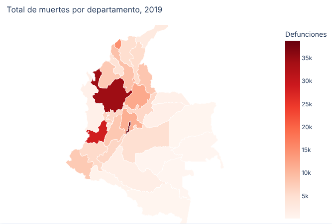
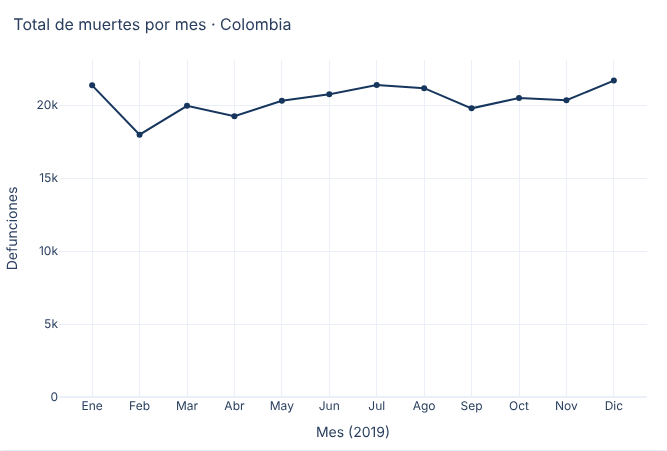
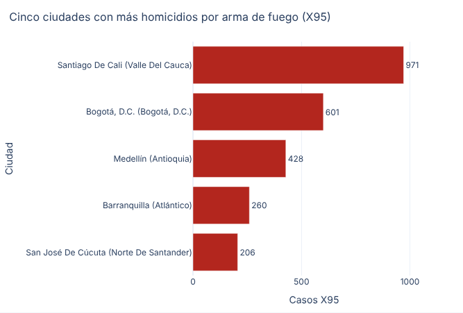
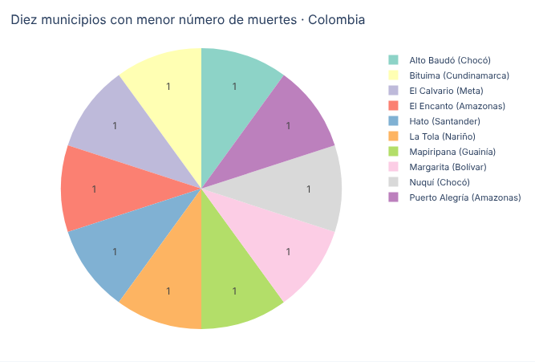
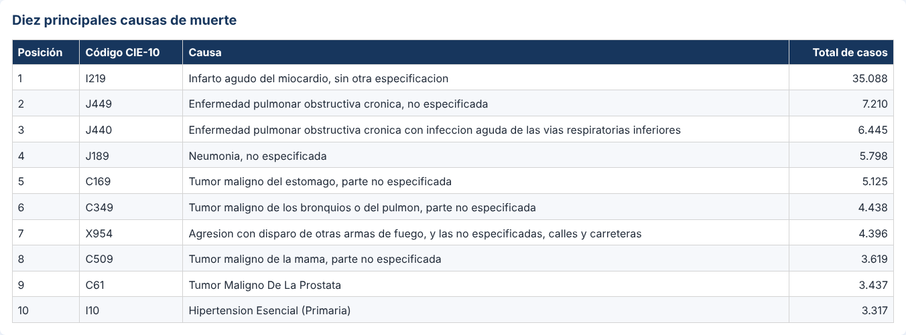
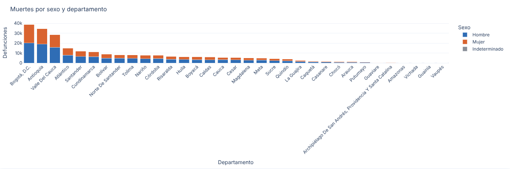
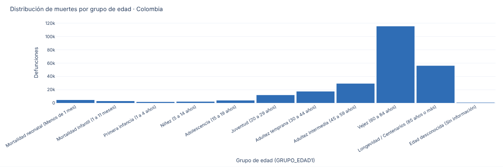
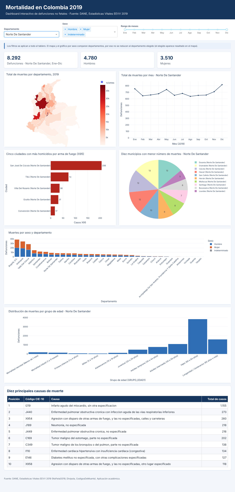

# Dashboard de mortalidad en Colombia 2019

**Integrantes:** Laura Vanesa Pinzón Moncada, Jesus David Acero Rueda  
**Aplicación en línea:** https://mortalidad-colombia-hugs.onrender.com/  
**Repositorio:** https://github.com/laurapinzon2409-hub/mortalidad-colombia

## Introducción del proyecto
Aplicación web dinámica hecha con Python, Dash y Plotly para explorar las **244.355 defunciones no fetales** registradas en Colombia en 2019 (DANE, Estadísticas Vitales EEVV). Permite ver la distribución territorial, la evolución mensual, las causas de muerte, las diferencias por sexo y la distribución por grupos de edad, con filtros por departamento, sexo y rango de meses.

## Objetivo
Facilitar la lectura visual de los datos de mortalidad para identificar patrones demográficos y regionales (dónde, cuándo, de qué y a qué edad se muere la gente en Colombia) mediante gráficos interactivos.

## Estructura del proyecto
```
├── app.py                  # Aplicación Dash: layout, filtros y 7 visualizaciones
├── preparar_datos.py       # Cruza los 3 Excel del DANE y genera data/mortalidad_2019.csv.gz
├── assets/style.css        # Estilos y diseño adaptable
├── data/
│   ├── NoFetal2019.xlsx            # Defunciones no fetales 2019 (DANE)
│   ├── Divipola.xlsx               # División político-administrativa
│   ├── CodigosDeMuerte.xlsx        # Catálogo CIE-10 de causas
│   ├── mortalidad_2019.csv.gz      # Datos ya cruzados (los lee la app; 3,5 MB)
│   └── colombia_departamentos.geojson  # Polígonos de departamentos para el mapa
├── capturas/               # Capturas de pantalla usadas en este README
├── requirements.txt        # Dependencias
└── Procfile                # Comando de inicio (gunicorn)
```

## Requisitos
Python 3.10 o superior (probado con 3.13) y:
```
dash==2.18.2
pandas==2.2.3
openpyxl==3.1.5
plotly==5.24.1
gunicorn==23.0.0
```

## Software utilizado
Python, Dash (aplicación web), Plotly Express (gráficos), pandas (datos), openpyxl (lectura de Excel), gunicorn (servidor de producción), Git/GitHub (código) y Render (PaaS).

## Instalación local
```bash
git clone https://github.com/laurapinzon2409-hub/mortalidad-colombia.git
cd mortalidad-colombia
python -m venv .venv
.venv\Scripts\activate          # Windows
source .venv/bin/activate       # Linux/macOS
pip install -r requirements.txt
python app.py
```
Abra http://127.0.0.1:8050. Si cambia los Excel de `data/`, regenere el cruce con `python preparar_datos.py`.

## Despliegue (Render)
1. Suba el proyecto a un repositorio de GitHub (público).
2. En https://render.com: **New → Web Service** y conecte el repositorio `mortalidad-colombia`.
3. Runtime: Python 3. **Build command:** `pip install -r requirements.txt`.
4. **Start command:** `gunicorn app:server`.
5. Plan **Free** y **Create Web Service**.
6. Al terminar el build, la app queda publicada en https://mortalidad-colombia-hugs.onrender.com/

> En el plan gratuito la app se "duerme" tras unos minutos sin uso; la primera visita puede tardar ~1 minuto. Por eso la app lee un CSV de 3,5 MB en vez del Excel de 19 MB (que consumiría demasiada memoria).

## Visualizaciones y hallazgos
Los filtros (departamento, sexo, meses) se aplican a todo el tablero; el mapa y el gráfico por sexo comparan departamentos, así que siempre muestran todos.

**1. Mapa por departamento.** Total de muertes por departamento (escala de rojos).
Hallazgo: Bogotá D.C. (38.760), Antioquia (34.473) y Valle del Cauca (28.443) concentran el 41,6 % de las muertes, coherente con su peso poblacional.


**2. Líneas: muertes por mes.**
Hallazgo: el año es bastante estable (≈20.000 por mes). Febrero es el mínimo (17.974, en parte por tener menos días) y diciembre el máximo (21.678).


**3. Barras: cinco ciudades con más homicidios por arma de fuego (código X95).**
Hallazgo: Cali (971), Bogotá (601), Medellín (428), Barranquilla (260) y Cúcuta (206). En total hay 9.273 casos X95 (3,8 % de las muertes) y el 93,5 % son hombres.


**4. Circular: diez municipios con menor mortalidad.**
Hallazgo: son municipios muy pequeños, casi todos de la Amazonia, el Chocó y el Pacífico. Hay 13 municipios empatados con 1 sola muerte; se muestran 10 con desempate alfabético. Solo se cuentan municipios con al menos un registro.


**5. Tabla: diez principales causas (código CIE-10, nombre y total).**
Hallazgo: el infarto agudo de miocardio (I219) lidera con 35.088 casos (14,4 % del total), muy por encima de la EPOC (J449, 7.210). Las agresiones con arma de fuego (X954) aparecen en el puesto 7.


**6. Barras apiladas: muertes por sexo y departamento.**
Hallazgo: en total 134.573 hombres (55,1 %), 109.689 mujeres y 93 casos indeterminados. La proporción de hombres va de 51,8 % en Bogotá hasta 77,1 % en Guaviare, donde pesa la mortalidad violenta.


**7. Histograma: grupos de edad (GRUPO_EDAD1 agrupado según la tabla de la actividad).**
Hallazgo: la mortalidad se concentra en la vejez: el 70,2 % de las muertes ocurre a los 60 años o más (el 22,9 % a los 85 o más). La mortalidad neonatal e infantil (<1 año) es solo el 3 % del total.


**Interacción:** al elegir un departamento, tarjetas, gráficos y tabla se recalculan y el mapa lo resalta.


## Notas metodológicas
- Se usan las 244.355 defunciones del archivo `NoFetal2019.xlsx` (todas de 2019).
- Cruce con Divipola por `COD_DANE` (5 dígitos) → 100 % con nombre de departamento y municipio. Cruce con el catálogo CIE-10 por `COD_MUERTE` (4 caracteres, o 3 cuando así viene) → 100 % con nombre de causa.
- Sexo: 1 = Hombre, 2 = Mujer, 3 = Indeterminado.
- X95 = código CIE-10 "agresión con disparo de otras armas de fuego, y las no especificadas" (X950–X959).
- Los grupos de edad usan la tabla de referencia de la actividad (0–4 neonatal, 5–6 infantil, 7–8 primera infancia, etc.).

Fuente: DANE, Estadísticas Vitales EEVV 2019 — https://microdatos.dane.gov.co/catalog/696
